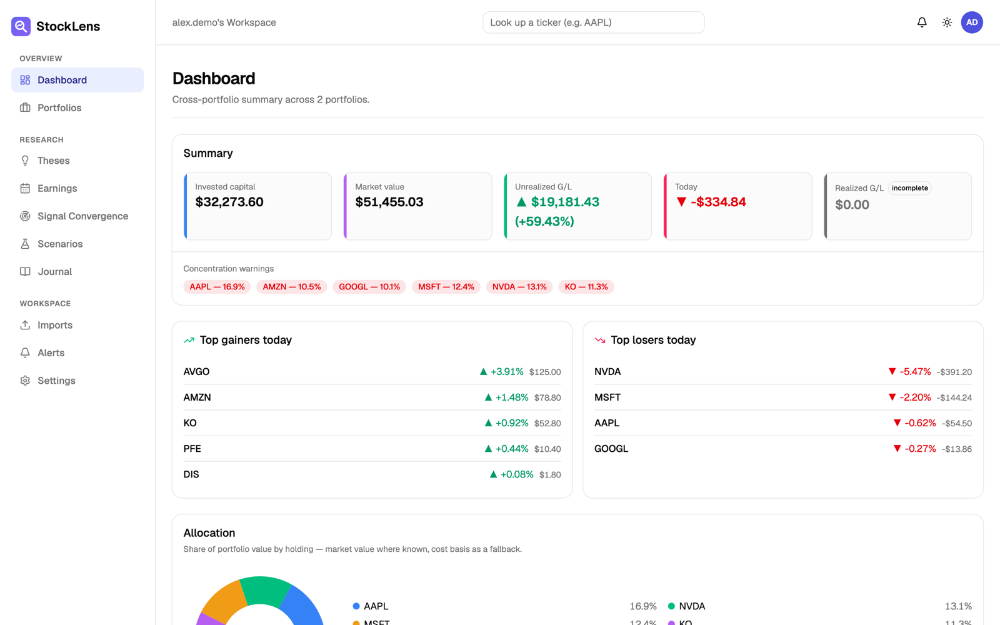
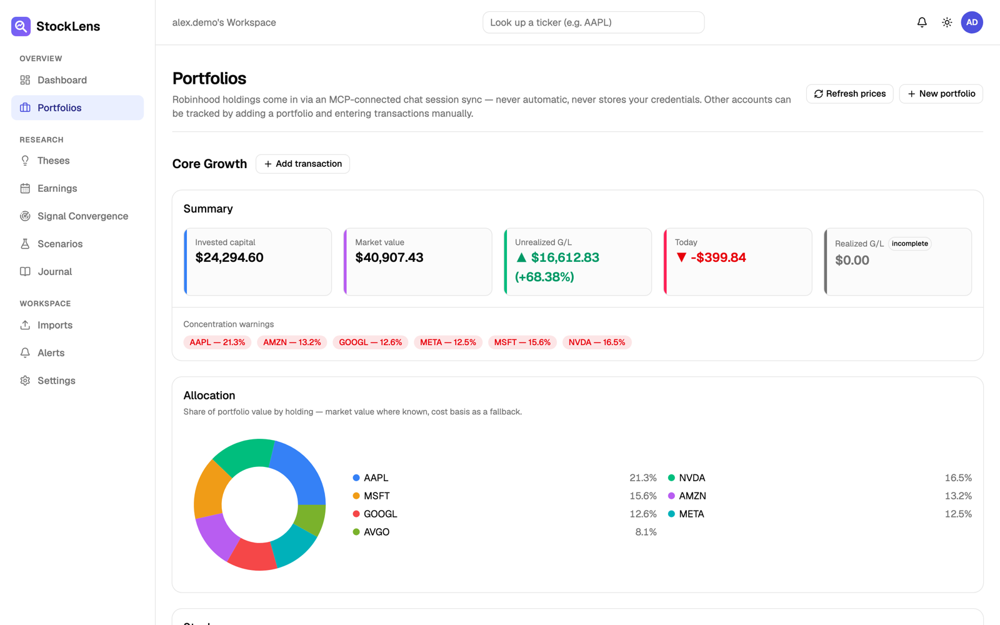
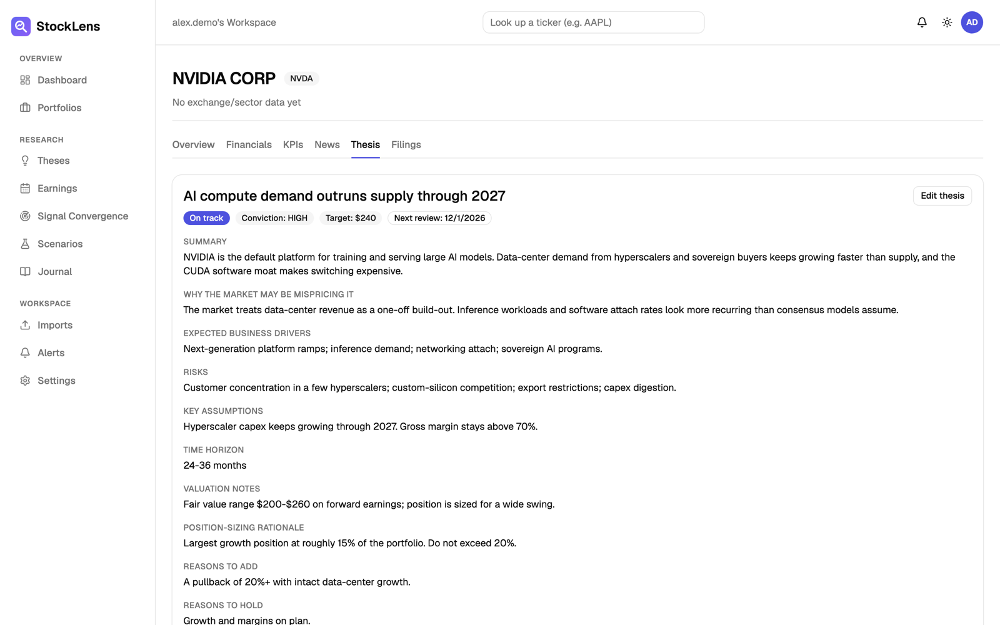
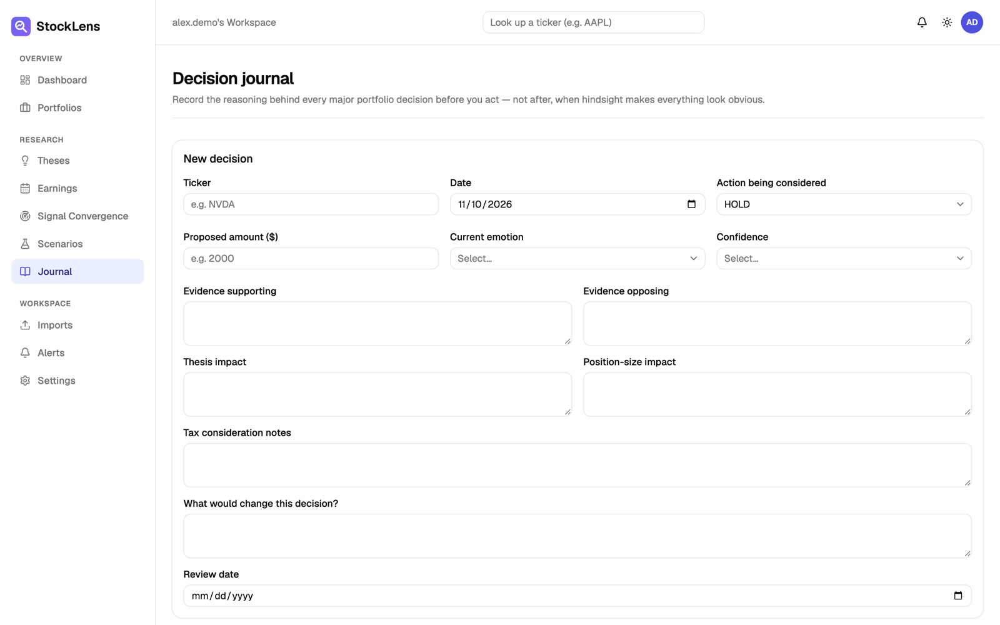
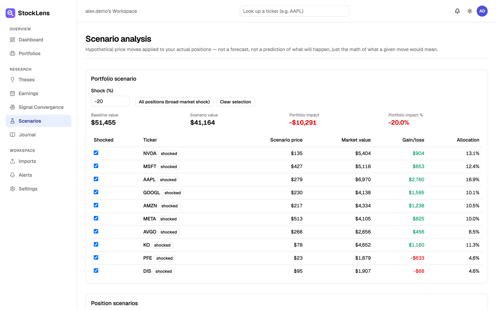
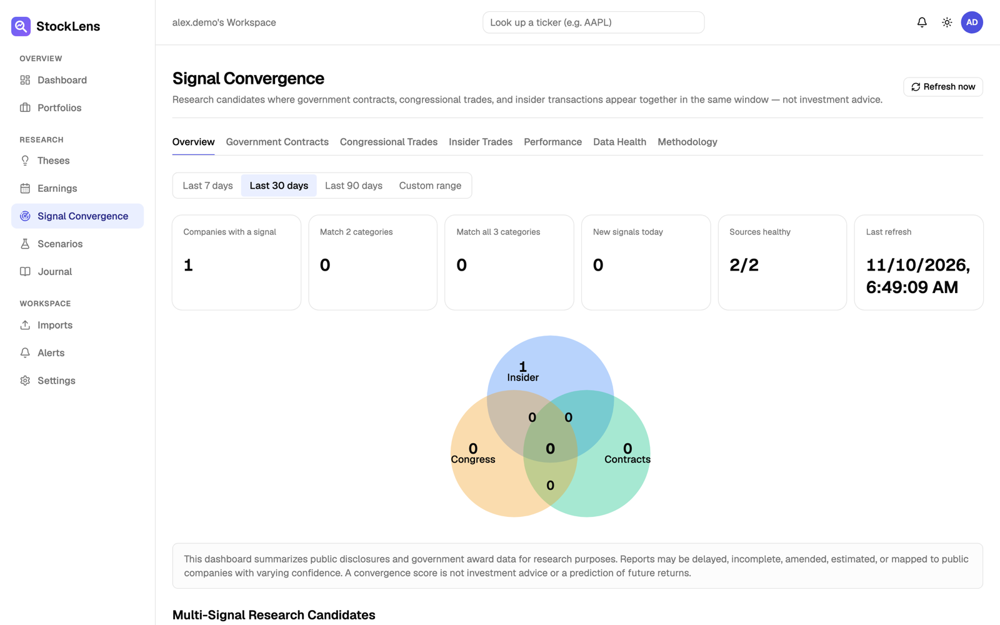
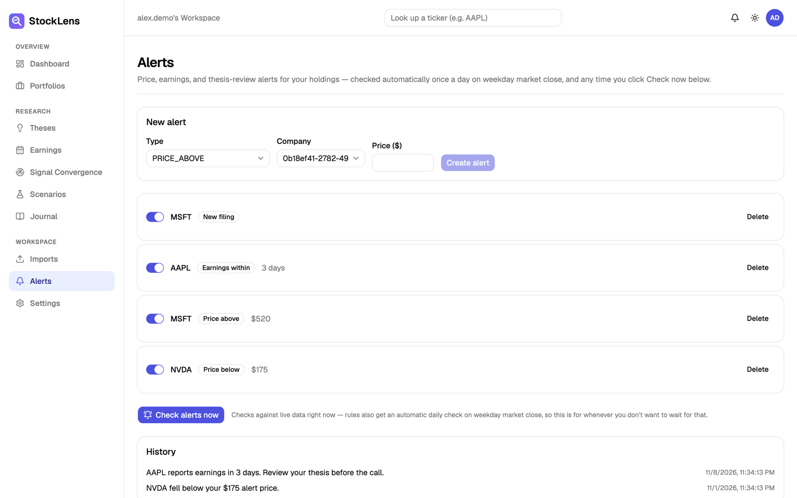

# StockLens

A plug-and-play investment research and thesis-tracking dashboard for any publicly traded company. See [`docs/phase-0/`](./docs/phase-0/README.md) for the full design package (PRD, architecture, database design, security model, implementation plan).

## Screenshots

All screenshots use made-up demo data — no real portfolio or account information.

| | |
|---|---|
|  **Dashboard** — cross-portfolio summary, concentration warnings, allocation, top movers |  **Portfolios** — holdings, cost basis, live prices, unrealized gain/loss |
|  **Thesis** — why you own a position, target price, invalidation conditions, review date |  **Decision journal** — record the reasoning and emotion behind each buy, add, trim or exit |
|  **Scenario analysis** — what a hypothetical price move does to your positions |  **Signal Convergence** — government contracts, congressional trades and insider transactions in one view |
|  **Alerts** — price, earnings and thesis-review alerts | |

## Stack

Next.js 15 (App Router) · TypeScript · Tailwind CSS · shadcn/ui · Prisma · PostgreSQL (Supabase) · Vercel

## Getting started

```bash
npm install
cp .env.example .env       # fill in Supabase/Prisma values — see .env.example for what each is for
npx prisma generate
npm run dev
```

Open [http://localhost:3000](http://localhost:3000).

## Project structure

Feature-based architecture — see [`docs/phase-0/03-folder-structure.md`](./docs/phase-0/03-folder-structure.md) for the full rationale. Short version:

- `src/app/` — routing and page composition only, no business logic
- `src/features/*/` — one directory per domain capability (portfolios, thesis, filings, alerts, …), each owning its own components/server logic/types
- `src/shared/` — cross-feature components, hooks, and provider interfaces (`contracts/`)
- `src/components/ui/` — shadcn/ui primitives
- `src/lib/` — cross-cutting infra: Prisma client, auth session helpers, env validation, logging, error types

## Security

The Robinhood brokerage integration is **read-only, permanently, enforced at the type level** (no write method exists on the sync provider interface) — see [`docs/phase-0/09-security-model.md`](./docs/phase-0/09-security-model.md) and [`ROBINHOOD_MCP_SECURITY_PLAN.md`](./ROBINHOOD_MCP_SECURITY_PLAN.md).

## Signal Convergence

Research tool that cross-references government contract awards, SEC insider transactions, and congressional trade disclosures — see [`src/features/signal-convergence/README.md`](./src/features/signal-convergence/README.md) for architecture, providers, environment variables, and known Phase 1 limitations. Not investment advice — see the in-app Methodology tab.
