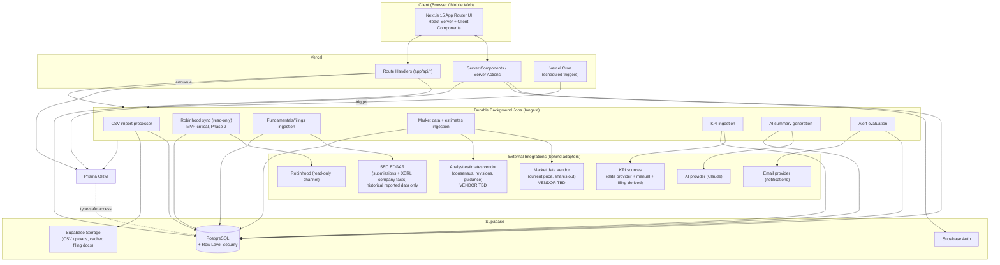

# System Architecture

## 1. High-level component diagram

## 2. Component responsibilities

| Component | Responsibility | Why this choice |
|---|---|---|
| **Next.js 15 (App Router)** | UI rendering, routing, Server Actions for same-request mutations, Route Handlers for external-facing/webhook-style endpoints | Co-locates data fetching with components (RSC), matches Vercel's deployment model, first-class TS support |
| **Prisma** | Single source of truth for schema, type-safe query layer, migrations | SOLID: isolates persistence details behind a typed client; no feature module hand-writes SQL |
| **Supabase Postgres** | System of record | Managed Postgres with connection pooling (pgbouncer), Auth, and Storage bundled — avoids standing up three separate vendors |
| **Supabase Auth** | Identity, session/JWT issuance, OAuth providers | Issues the JWT that both the client (Supabase client for RLS-scoped reads, if used) and the server (via `sub` claim) use to identify the user |
| **Supabase Storage** | Raw CSV uploads, cached filing PDFs/HTML | Keeps large blobs out of Postgres rows |
| **Inngest (durable jobs)** | CSV processing, Robinhood sync, fundamentals/filing ingestion, market data + estimates ingestion, KPI ingestion, AI summary generation, alert evaluation | Vercel serverless functions are time-boxed; these jobs are retryable, potentially slow (LLM calls, third-party rate limits), and need step-level retry/observability that a bare `fetch`-in-a-cron does not give you |
| **Vercel Cron** | Time-based triggers (nightly price/metric refresh, estimate/guidance refresh, daily filing poll, alert sweep) | Native to the hosting platform, no extra infra |
| **SEC EDGAR** | Filings metadata + XBRL structured historical financial facts | Free, authoritative, no per-vendor lock-in — but historical-reported-data only, see the constraint below |
| **Market data vendor** *(TBD)* | Current price, shares outstanding — inputs to market cap/EV/valuation | SEC EDGAR has none of this; a real vendor decision blocks Phase 3's `MarketDataProvider` |
| **Analyst estimates vendor** *(TBD)* | Consensus revenue/EPS, revisions, guidance, surprise history | SEC EDGAR has none of this either; blocks all of Phase 4 until decided |
| **KPI sources** | Industry-specific company KPIs (SaaS NRR, retail same-store sales, etc.) | Composite: data-provider-sourced and manually-maintained first; filing-derived extraction is a stretch goal (see [11-implementation-plan.md Phase 5](./11-implementation-plan.md#phase-5--company-specific-kpi-framework)), not a data-fetch problem — most KPIs aren't standardized/tagged the way XBRL financials are |
| **Robinhood (read-only)** | Portfolio sync source, MVP-critical | Same operating boundary as `ROBINHOOD_MCP_SECURITY_PLAN.md`: read-only, credentials never stored in plaintext, no write-capable call path exists in this integration's code at all (not just "unused") — see [09-security-model.md §3](./09-security-model.md#3-robinhood-integration-boundary) for the full safety requirement list |
| **AI provider (Claude)** | Filing/earnings summarization, thesis-drift detection, eventually filing-derived KPI extraction | Called only from background jobs, never inline in a request/response cycle, so latency/cost never blocks page loads |

## 3. Why feature-based architecture (and what it buys us)

Each domain capability (`portfolios`, `theses`, `filings`, `financial-metrics`, `market-data`, `analyst-estimates`, `company-kpis`, `earnings`, `alerts`, `ai-summaries`, `csv-import`, `brokerage-sync`) owns its server logic, types, and UI components in one directory (see [03-folder-structure.md](./03-folder-structure.md)). `app/` stays a thin routing layer that imports from features. This gives us:

- **Single Responsibility**: a feature module changes for one reason (that domain's rules changing), not because routing changed.
- **Open/Closed**: adding `brokerage-sync` for a second broker later means adding a new adapter behind the existing `BrokerageSyncProvider` interface, not touching `portfolios`. Same for swapping a market-data or estimates vendor once one is chosen — the choice lives in one adapter, not scattered through feature code.
- **Dependency Inversion**: features depend on interfaces (`FilingProvider`, `FundamentalDataProvider`, `MarketDataProvider`, `AnalystEstimateProvider`, `CompanyKPIProvider`, `AISummaryProvider`, `BrokerageSyncProvider`) defined in `src/shared/contracts`, and the concrete implementations are injected at the edge (job handler / route handler), not imported deep inside feature logic. This is what makes "swap the financial data vendor" or "add a second broker" a contained change. (`FundamentalDataProvider` and `FilingProvider` are the Phase 3 renames of the existing `MetricsProvider`/`FilingsProvider` — the rename happens when that phase's implementation starts, not speculatively now; see [11-implementation-plan.md Phase 3](./11-implementation-plan.md#phase-3--reported-fundamentals-expanded--market-data--valuation).)
- **Independent testability**: each feature's server logic can be unit-tested against a mocked Prisma client and mocked provider interfaces without booting the whole app. This is also how Phase 2's Robinhood safety requirement ("tests proving application code cannot invoke write-capable operations") gets verified — against the interface and adapter directly, not by exercising a live account.

## 4. Multi-tenancy posture (SaaS-readiness)

V1 ships single-user workspaces, but every tenant-owned table carries a `workspaceId`, and `Workspace` has a `WorkspaceMember` join table from the start (role: `OWNER` for V1, `EDITOR`/`VIEWER` reserved). This means Phase 9's multi-seat teams is a UI + authorization change, not a schema migration touching every table. Physical isolation (per-tenant DB/schema) is explicitly deferred — logical isolation via `workspaceId` + Postgres RLS is sufficient until there's a concrete enterprise/compliance requirement forcing otherwise.

## 5. Environments

| Environment | Purpose | Notes |
|---|---|---|
| `local` | Development | Local `.env`, Supabase local dev stack or a dedicated dev project, Prisma migrations run manually |
| `preview` | Per-PR Vercel preview deployments | Points at a shared Supabase "staging" project; seeded with synthetic multi-ticker data, never real brokerage credentials |
| `production` | Live | Separate Supabase project, separate secrets, Inngest production environment |

## 6. Key architectural risks

Flagged now, addressed in later docs.

1. **Robinhood has no official API — and it's now MVP-critical, not deferred.** Contained by treating it as a single, isolated, read-only adapter (see [09-security-model.md §3](./09-security-model.md#3-robinhood-integration-boundary)) — if it breaks or has to be removed, no other feature depends on it. But because Phase 2 of the golden path depends on it directly, this fragility is a launch risk to actively monitor, not a background concern.
2. **Serverless execution limits.** Contained by pushing anything slow/retryable (imports, sync, ingestion jobs, AI) into Inngest jobs instead of request-cycle code.
3. **Market data and analyst estimates are hard, unresolved vendor dependencies — not additive, blocking.** Unlike the original plan (where a paid financial-data vendor was optional polish on top of free EDGAR data), Phases 3 and 4 of the current plan cannot ship for real without picking and contracting a market-data vendor and an estimates vendor respectively. This is called out explicitly everywhere it applies (PRD, implementation plan) instead of being implied away — SEC EDGAR has no current prices, no consensus estimates, no guidance, and pretending otherwise would misrepresent what Phase 3/4 can actually deliver until that decision is made.
4. **Company-specific KPIs resist full automation.** Most industry KPIs live in unstructured earnings-release prose, not standardized tags. `CompanyKPIProvider` is designed as a composite (data-provider + manual + filing-derived) specifically so Phase 5 can ship with the first two working, rather than blocking on solving filing-derived extraction — which is closer to an AI-extraction problem (Phase 9's territory) than a Phase 5 data-fetch problem.
