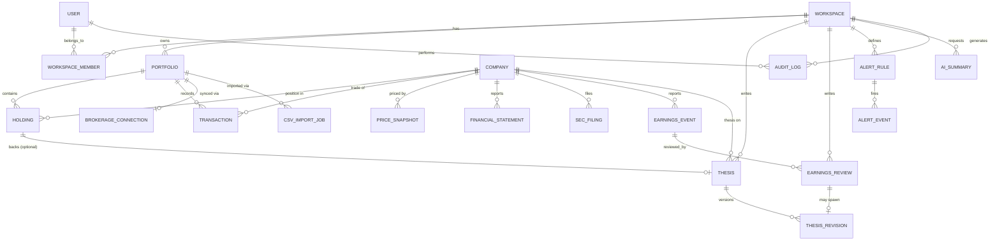

# Prisma Entity Diagram

This is a design artifact — an illustrative `schema.prisma` and its ERD — not a file to be committed as-is. Phase 1 scaffolding will generate the real `prisma/schema.prisma` from this design, adjusting for whatever Prisma/Supabase version is current at build time.

## 1. Entity-relationship diagram



## 2. Illustrative `schema.prisma`

```prisma
// ─────────────────────────────────────────────────────────────
// Generator / datasource
// ─────────────────────────────────────────────────────────────
generator client {
  provider = "prisma-client-js"
}

datasource db {
  provider  = "postgresql"
  url       = env("DATABASE_URL")       // pooled (pgbouncer) connection
  directUrl = env("DIRECT_URL")         // direct connection, migrations only
}

// ─────────────────────────────────────────────────────────────
// Identity & tenancy
// ─────────────────────────────────────────────────────────────
model User {
  id            String   @id @db.Uuid   // mirrors auth.users.id
  email         String   @unique
  displayName   String?
  createdAt     DateTime @default(now())

  memberships   WorkspaceMember[]
  auditLogs     AuditLog[]
}

model Workspace {
  id          String   @id @default(uuid()) @db.Uuid
  name        String
  createdAt   DateTime @default(now())

  members             WorkspaceMember[]
  portfolios          Portfolio[]
  theses              Thesis[]
  earningsReviews     EarningsReview[]
  alertRules          AlertRule[]
  aiSummaries         AISummary[]
  auditLogs           AuditLog[]
}

enum WorkspaceRole {
  OWNER
  EDITOR
  VIEWER
}

model WorkspaceMember {
  id          String        @id @default(uuid()) @db.Uuid
  workspaceId String        @db.Uuid
  userId      String        @db.Uuid
  role        WorkspaceRole @default(OWNER)
  createdAt   DateTime      @default(now())

  workspace   Workspace @relation(fields: [workspaceId], references: [id], onDelete: Cascade)
  user        User      @relation(fields: [userId], references: [id], onDelete: Cascade)

  @@unique([workspaceId, userId])
  @@index([userId])
}

// ─────────────────────────────────────────────────────────────
// Portfolios & positions
// ─────────────────────────────────────────────────────────────
enum PortfolioSource {
  MANUAL
  CSV_IMPORT
  ROBINHOOD_SYNC
}

model Portfolio {
  id           String          @id @default(uuid()) @db.Uuid
  workspaceId  String          @db.Uuid
  name         String
  source       PortfolioSource @default(MANUAL)
  createdAt    DateTime        @default(now())
  updatedAt    DateTime        @updatedAt

  workspace           Workspace            @relation(fields: [workspaceId], references: [id], onDelete: Cascade)
  holdings             Holding[]
  transactions         Transaction[]
  brokerageConnection  BrokerageConnection?
  csvImportJobs        CsvImportJob[]

  @@index([workspaceId])
}

model Holding {
  id             String   @id @default(uuid()) @db.Uuid
  portfolioId    String   @db.Uuid
  companyId      String   @db.Uuid
  quantity       Decimal  @db.Decimal(20, 6)
  averageCost    Decimal  @db.Decimal(20, 4)
  updatedAt      DateTime @updatedAt

  portfolio      Portfolio @relation(fields: [portfolioId], references: [id], onDelete: Cascade)
  company        Company   @relation(fields: [companyId], references: [id])
  thesis         Thesis?

  @@unique([portfolioId, companyId])
  @@index([companyId])
}

enum TransactionType {
  BUY
  SELL
  DIVIDEND
  SPLIT
}

model Transaction {
  id           String          @id @default(uuid()) @db.Uuid
  portfolioId  String          @db.Uuid
  companyId    String          @db.Uuid
  type         TransactionType
  quantity     Decimal         @db.Decimal(20, 6)
  price        Decimal         @db.Decimal(20, 4)
  fees         Decimal?        @db.Decimal(20, 4)
  occurredAt   DateTime
  source       PortfolioSource @default(MANUAL)
  externalId   String?         // broker/CSV-provided id, for idempotent re-sync
  createdAt    DateTime        @default(now())

  portfolio    Portfolio @relation(fields: [portfolioId], references: [id], onDelete: Cascade)
  company      Company   @relation(fields: [companyId], references: [id])

  @@index([portfolioId, occurredAt])
  @@unique([portfolioId, externalId])
}

enum BrokerageConnectionStatus {
  CONNECTED
  NEEDS_REAUTH
  DISCONNECTED
  ERROR
}

model BrokerageConnection {
  id                String                    @id @default(uuid()) @db.Uuid
  portfolioId       String                    @unique @db.Uuid
  provider          String                    @default("ROBINHOOD")
  status            BrokerageConnectionStatus @default(CONNECTED)
  credentialRef     String                    // reference/ID into external secret store — never the credential itself
  scopes            String[]                  // e.g. ["read:positions", "read:transactions"] — write scopes never issued
  lastSyncedAt      DateTime?
  createdAt         DateTime                  @default(now())

  portfolio         Portfolio @relation(fields: [portfolioId], references: [id], onDelete: Cascade)
}

enum CsvImportStatus {
  PENDING
  PROCESSING
  COMPLETED
  FAILED
}

model CsvImportJob {
  id            String          @id @default(uuid()) @db.Uuid
  portfolioId   String          @db.Uuid
  status        CsvImportStatus @default(PENDING)
  storagePath   String          // Supabase Storage object path
  columnMapping Json
  rowsTotal     Int?
  rowsSucceeded Int?
  rowsFailed    Int?
  errorDetail   Json?
  createdAt     DateTime        @default(now())
  completedAt   DateTime?

  portfolio     Portfolio @relation(fields: [portfolioId], references: [id], onDelete: Cascade)

  @@index([portfolioId])
}

// ─────────────────────────────────────────────────────────────
// Company & market data — GLOBAL reference data (no workspaceId)
// ─────────────────────────────────────────────────────────────
model Company {
  id        String   @id @default(uuid()) @db.Uuid
  ticker    String   @unique @db.Citext
  cik       String?  @unique
  name      String
  exchange  String?
  sector    String?
  industry  String?
  updatedAt DateTime @updatedAt

  holdings            Holding[]
  transactions        Transaction[]
  priceSnapshots      PriceSnapshot[]
  financialStatements FinancialStatement[]
  secFilings          SecFiling[]
  earningsEvents      EarningsEvent[]
  theses              Thesis[]
}

model PriceSnapshot {
  id        String   @id @default(uuid()) @db.Uuid
  companyId String   @db.Uuid
  asOfDate  DateTime @db.Date
  open      Decimal? @db.Decimal(20, 4)
  high      Decimal? @db.Decimal(20, 4)
  low       Decimal? @db.Decimal(20, 4)
  close     Decimal  @db.Decimal(20, 4)
  volume    BigInt?

  company   Company @relation(fields: [companyId], references: [id], onDelete: Cascade)

  @@unique([companyId, asOfDate])
}

enum FiscalPeriod {
  Q1
  Q2
  Q3
  Q4
  FY
}

model FinancialStatement {
  id            String       @id @default(uuid()) @db.Uuid
  companyId     String       @db.Uuid
  fiscalYear    Int
  fiscalPeriod  FiscalPeriod
  revenue       Decimal?     @db.Decimal(24, 2)
  netIncome     Decimal?     @db.Decimal(24, 2)
  grossProfit   Decimal?     @db.Decimal(24, 2)
  eps           Decimal?     @db.Decimal(10, 4)
  totalAssets   Decimal?     @db.Decimal(24, 2)
  totalLiabilities Decimal?  @db.Decimal(24, 2)
  sourceUrl     String?
  fetchedAt     DateTime     @default(now())

  company       Company @relation(fields: [companyId], references: [id], onDelete: Cascade)

  @@unique([companyId, fiscalYear, fiscalPeriod])
}

model SecFiling {
  id              String   @id @default(uuid()) @db.Uuid
  companyId       String   @db.Uuid
  formType        String   // "10-K", "10-Q", "8-K", …
  accessionNumber String   @unique
  filedAt         DateTime
  periodOfReport  DateTime?
  documentUrl     String
  fetchedAt       DateTime @default(now())

  company         Company     @relation(fields: [companyId], references: [id], onDelete: Cascade)
  aiSummaries     AISummary[]

  @@index([companyId, filedAt])
}

model EarningsEvent {
  id             String    @id @default(uuid()) @db.Uuid
  companyId      String    @db.Uuid
  fiscalYear     Int
  fiscalPeriod   FiscalPeriod
  reportDate     DateTime
  epsEstimate    Decimal?  @db.Decimal(10, 4)
  epsActual      Decimal?  @db.Decimal(10, 4)
  revenueEstimate Decimal? @db.Decimal(24, 2)
  revenueActual   Decimal? @db.Decimal(24, 2)

  company        Company          @relation(fields: [companyId], references: [id], onDelete: Cascade)
  reviews        EarningsReview[]
  aiSummaries    AISummary[]

  @@unique([companyId, fiscalYear, fiscalPeriod])
  @@index([companyId, reportDate])
}

// ─────────────────────────────────────────────────────────────
// Thesis & review — tenant-owned
// ─────────────────────────────────────────────────────────────
enum ConvictionLevel {
  LOW
  MEDIUM
  HIGH
}

enum ThesisStatus {
  ACTIVE
  NEEDS_REVIEW
  CLOSED
}

model Thesis {
  id          String          @id @default(uuid()) @db.Uuid
  workspaceId String          @db.Uuid
  companyId   String          @db.Uuid
  holdingId   String?         @unique @db.Uuid
  summary     String
  conviction  ConvictionLevel @default(MEDIUM)
  targetPrice Decimal?        @db.Decimal(20, 4)
  status      ThesisStatus    @default(ACTIVE)
  createdAt   DateTime        @default(now())
  updatedAt   DateTime        @updatedAt

  workspace   Workspace         @relation(fields: [workspaceId], references: [id], onDelete: Cascade)
  company     Company           @relation(fields: [companyId], references: [id])
  holding     Holding?          @relation(fields: [holdingId], references: [id])
  revisions   ThesisRevision[]
  aiSummaries AISummary[]

  @@index([workspaceId])
  @@index([companyId])
}

enum ThesisRevisionTrigger {
  MANUAL_EDIT
  EARNINGS_REVIEW
  FILING_REVIEW
}

model ThesisRevision {
  id          String                 @id @default(uuid()) @db.Uuid
  thesisId    String                 @db.Uuid
  summary     String
  conviction  ConvictionLevel
  targetPrice Decimal?               @db.Decimal(20, 4)
  trigger     ThesisRevisionTrigger  @default(MANUAL_EDIT)
  createdAt   DateTime               @default(now())

  thesis          Thesis           @relation(fields: [thesisId], references: [id], onDelete: Cascade)
  earningsReview  EarningsReview?

  @@index([thesisId, createdAt])
}

model EarningsReview {
  id               String    @id @default(uuid()) @db.Uuid
  workspaceId      String    @db.Uuid
  earningsEventId  String    @db.Uuid
  notes            String
  affectsThesis    Boolean   @default(false)
  spawnedRevisionId String?  @unique @db.Uuid
  createdAt        DateTime  @default(now())

  workspace        Workspace       @relation(fields: [workspaceId], references: [id], onDelete: Cascade)
  earningsEvent    EarningsEvent   @relation(fields: [earningsEventId], references: [id], onDelete: Cascade)
  spawnedRevision  ThesisRevision? @relation(fields: [spawnedRevisionId], references: [id])

  @@index([workspaceId])
}

// ─────────────────────────────────────────────────────────────
// Alerts — tenant-owned
// ─────────────────────────────────────────────────────────────
enum AlertType {
  PRICE_ABOVE
  PRICE_BELOW
  NEW_FILING
  UPCOMING_EARNINGS
  THESIS_STALE
}

model AlertRule {
  id          String    @id @default(uuid()) @db.Uuid
  workspaceId String    @db.Uuid
  companyId   String?   @db.Uuid
  thesisId    String?   @db.Uuid
  type        AlertType
  config      Json      // e.g. { "threshold": 150.00 } or { "daysBefore": 3 }
  active      Boolean   @default(true)
  createdAt   DateTime  @default(now())

  workspace   Workspace    @relation(fields: [workspaceId], references: [id], onDelete: Cascade)
  events      AlertEvent[]

  @@index([workspaceId])
  @@index([active, type])
}

enum AlertDeliveryStatus {
  PENDING
  SENT
  FAILED
}

enum AlertChannel {
  EMAIL
  IN_APP
}

model AlertEvent {
  id             String              @id @default(uuid()) @db.Uuid
  alertRuleId    String              @db.Uuid
  payload        Json
  channel        AlertChannel
  deliveryStatus AlertDeliveryStatus @default(PENDING)
  firedAt        DateTime            @default(now())
  deliveredAt    DateTime?

  alertRule      AlertRule @relation(fields: [alertRuleId], references: [id], onDelete: Cascade)

  @@index([alertRuleId, firedAt])
}

// ─────────────────────────────────────────────────────────────
// AI summaries — tenant-owned, content-addressed cache
// ─────────────────────────────────────────────────────────────
enum AISummarySubjectType {
  SEC_FILING
  EARNINGS_EVENT
  THESIS
}

model AISummary {
  id           String               @id @default(uuid()) @db.Uuid
  workspaceId  String               @db.Uuid
  subjectType  AISummarySubjectType
  secFilingId      String?          @db.Uuid
  earningsEventId  String?          @db.Uuid
  thesisId         String?          @db.Uuid
  inputHash    String               // hash(subject content + prompt version + model id)
  model        String
  promptVersion String
  content      String
  createdAt    DateTime             @default(now())

  workspace    Workspace      @relation(fields: [workspaceId], references: [id], onDelete: Cascade)
  secFiling    SecFiling?     @relation(fields: [secFilingId], references: [id])
  earningsEvent EarningsEvent? @relation(fields: [earningsEventId], references: [id])
  thesis       Thesis?        @relation(fields: [thesisId], references: [id])

  @@unique([subjectType, secFilingId, earningsEventId, thesisId, inputHash])
}

// ─────────────────────────────────────────────────────────────
// Cross-cutting
// ─────────────────────────────────────────────────────────────
model AuditLog {
  id          String   @id @default(uuid()) @db.Uuid
  workspaceId String   @db.Uuid
  userId      String   @db.Uuid
  action      String   // "BROKERAGE_CONNECTED", "WORKSPACE_MEMBER_ADDED", …
  metadata    Json?
  createdAt   DateTime @default(now())

  workspace   Workspace @relation(fields: [workspaceId], references: [id], onDelete: Cascade)
  user        User      @relation(fields: [userId], references: [id])

  @@index([workspaceId, createdAt])
}
```

## 3. Notes on modeling choices

- **`AISummary` uses nullable FKs instead of a polymorphic table + `subjectId`** because Prisma has no native polymorphic association, and a `subjectType` + `subjectId` string pair loses referential integrity (no FK constraint). Three nullable relations with a `subjectType` discriminant keeps FK enforcement at the cost of some nullability — acceptable given `AISummary` rows are cache entries, not critical records.
- **`Holding` is not user-editable once `Transaction` rows exist for that `(portfolio, company)` pair.** The service layer recomputes `quantity`/`averageCost` from transactions on every write; this keeps `Holding` a derived read-model rather than a second source of truth that can drift.
- **`Transaction.externalId` + unique `(portfolioId, externalId)`** is the idempotency mechanism for both CSV re-imports and Robinhood re-syncs — re-running either is always safe.
- **`Company` and its market-data children have no `workspaceId`** by design (see [04-database-design.md §2.3](./04-database-design.md#23-company--market-data-shared-across-all-tenants--not-workspace-scoped)) — they're shared reference data, deduplicated across all tenants.
