# Prisma Entity Diagram

This is a design artifact — an illustrative `schema.prisma` and its ERD — not a file to be committed as-is. The actual `prisma/schema.prisma` (Phase 1, already built) diverges slightly in generator/datasource mechanics because Prisma 7 shipped between Phase 0 and Phase 1 implementation (driver adapters, `prisma.config.ts` for connection URLs, `Company.ticker` as a plain `String` instead of `citext`) — this doc has been brought in line with that reality rather than left showing the pre-Prisma-7 shape. See `docs/phase-0/09-security-model.md §2` for why connection URLs live outside this file.

**Revision note**: this schema was expanded to support the Robinhood-first golden path. New models: `AnalystEstimate`, `Guidance`, `IndustryMetricTemplate`, `CompanyMetricDefinition`, `CompanyKPIValue`, `Catalyst`, `Risk`. `FinancialStatement` broadened from 6 fields to the full core-metrics list. `PriceSnapshot` gained `sharesOutstanding`/`marketCap`. `ThesisStatus` remapped to monitoring states. See [04-database-design.md](./04-database-design.md) for the rationale behind each addition and [11-implementation-plan.md](./11-implementation-plan.md) for which phase ships it.

## 1. Entity-relationship diagram

```mermaid
erDiagram
    WORKSPACE ||--o{ WORKSPACE_MEMBER : has
    USER ||--o{ WORKSPACE_MEMBER : belongs_to
    WORKSPACE ||--o{ PORTFOLIO : owns
    PORTFOLIO ||--o{ HOLDING : contains
    PORTFOLIO ||--o{ TRANSACTION : records
    PORTFOLIO ||--o| BROKERAGE_CONNECTION : "synced via"
    PORTFOLIO ||--o{ CSV_IMPORT_JOB : "imported via"
    COMPANY ||--o{ HOLDING : "position in"
    COMPANY ||--o{ TRANSACTION : "trade of"
    COMPANY ||--o{ PRICE_SNAPSHOT : "priced by"
    COMPANY ||--o{ FINANCIAL_STATEMENT : reports
    COMPANY ||--o{ SEC_FILING : files
    COMPANY ||--o{ EARNINGS_EVENT : reports
    COMPANY ||--o{ ANALYST_ESTIMATE : "estimated by"
    COMPANY ||--o{ GUIDANCE : issues
    COMPANY ||--o{ COMPANY_METRIC_DEFINITION : "overrides (optional)"
    COMPANY ||--o{ COMPANY_KPI_VALUE : reports
    INDUSTRY_METRIC_TEMPLATE ||--o{ COMPANY_METRIC_DEFINITION : defines
    COMPANY_METRIC_DEFINITION ||--o{ COMPANY_KPI_VALUE : "values for"
    WORKSPACE ||--o{ THESIS : writes
    COMPANY ||--o{ THESIS : "thesis on"
    HOLDING ||--o| THESIS : "backs (optional)"
    THESIS ||--o{ THESIS_REVISION : versions
    WORKSPACE ||--o{ CATALYST : tracks
    COMPANY ||--o{ CATALYST : "catalyst for"
    THESIS ||--o{ CATALYST : "linked to (optional)"
    WORKSPACE ||--o{ RISK : tracks
    COMPANY ||--o{ RISK : "risk for"
    THESIS ||--o{ RISK : "linked to (optional)"
    EARNINGS_EVENT ||--o{ EARNINGS_REVIEW : reviewed_by
    WORKSPACE ||--o{ EARNINGS_REVIEW : writes
    EARNINGS_REVIEW ||--o| THESIS_REVISION : "may spawn"
    WORKSPACE ||--o{ ALERT_RULE : defines
    ALERT_RULE ||--o{ ALERT_EVENT : fires
    WORKSPACE ||--o{ AI_SUMMARY : requests
    WORKSPACE ||--o{ AUDIT_LOG : generates
    USER ||--o{ AUDIT_LOG : performs
```



## 2. Illustrative `schema.prisma`

```prisma
// ─────────────────────────────────────────────────────────────
// Generator / datasource
// Connection URLs (DATABASE_URL / DIRECT_URL / SERVICE_DATABASE_URL) live
// in prisma.config.ts, not here — Prisma 7 driver-adapter convention.
// See docs/phase-0/09-security-model.md §2.
// ─────────────────────────────────────────────────────────────
generator client {
  provider = "prisma-client"
  output   = "../src/generated/prisma"
}

datasource db {
  provider = "postgresql"
}

// ─────────────────────────────────────────────────────────────
// Identity & tenancy
// ─────────────────────────────────────────────────────────────
model User {
  id            String   @id @db.Uuid   // mirrors auth.users.id
  email         String   @unique
  displayName   String?
  createdAt     DateTime @default(now())

  memberships   WorkspaceMember[]
  auditLogs     AuditLog[]
}

model Workspace {
  id          String   @id @default(uuid()) @db.Uuid
  name        String
  createdAt   DateTime @default(now())

  members         WorkspaceMember[]
  portfolios      Portfolio[]
  theses          Thesis[]
  catalysts       Catalyst[]
  risks           Risk[]
  earningsReviews EarningsReview[]
  alertRules      AlertRule[]
  aiSummaries     AISummary[]
  auditLogs       AuditLog[]
}

enum WorkspaceRole {
  OWNER
  EDITOR
  VIEWER
}

model WorkspaceMember {
  id          String        @id @default(uuid()) @db.Uuid
  workspaceId String        @db.Uuid
  userId      String        @db.Uuid
  role        WorkspaceRole @default(OWNER)
  createdAt   DateTime      @default(now())

  workspace   Workspace @relation(fields: [workspaceId], references: [id], onDelete: Cascade)
  user        User      @relation(fields: [userId], references: [id], onDelete: Cascade)

  @@unique([workspaceId, userId])
  @@index([userId])
}

// ─────────────────────────────────────────────────────────────
// Portfolios & positions
// ─────────────────────────────────────────────────────────────
enum PortfolioSource {
  MANUAL
  CSV_IMPORT
  ROBINHOOD_SYNC
}

model Portfolio {
  id           String          @id @default(uuid()) @db.Uuid
  workspaceId  String          @db.Uuid
  name         String
  source       PortfolioSource @default(MANUAL)
  createdAt    DateTime        @default(now())
  updatedAt    DateTime        @updatedAt

  workspace            Workspace            @relation(fields: [workspaceId], references: [id], onDelete: Cascade)
  holdings             Holding[]
  transactions         Transaction[]
  brokerageConnection  BrokerageConnection?
  csvImportJobs        CsvImportJob[]

  @@index([workspaceId])
}

model Holding {
  id             String   @id @default(uuid()) @db.Uuid
  portfolioId    String   @db.Uuid
  companyId      String   @db.Uuid
  quantity       Decimal  @db.Decimal(20, 6)
  averageCost    Decimal  @db.Decimal(20, 4)
  updatedAt      DateTime @updatedAt

  portfolio      Portfolio @relation(fields: [portfolioId], references: [id], onDelete: Cascade)
  company        Company   @relation(fields: [companyId], references: [id])
  thesis         Thesis?

  @@unique([portfolioId, companyId])
  @@index([companyId])
}

enum TransactionType {
  BUY
  SELL
  DIVIDEND
  SPLIT
}

model Transaction {
  id           String          @id @default(uuid()) @db.Uuid
  portfolioId  String          @db.Uuid
  companyId    String          @db.Uuid
  type         TransactionType
  quantity     Decimal         @db.Decimal(20, 6)
  price        Decimal         @db.Decimal(20, 4)
  fees         Decimal?        @db.Decimal(20, 4)
  occurredAt   DateTime
  source       PortfolioSource @default(MANUAL)
  externalId   String?         // broker/CSV-provided id, for idempotent re-sync/re-import
  createdAt    DateTime        @default(now())

  portfolio    Portfolio @relation(fields: [portfolioId], references: [id], onDelete: Cascade)
  company      Company   @relation(fields: [companyId], references: [id])

  @@unique([portfolioId, externalId])
  @@index([portfolioId, occurredAt])
}

enum BrokerageConnectionStatus {
  CONNECTED
  NEEDS_REAUTH
  DISCONNECTED
  ERROR
}

model BrokerageConnection {
  id                String                    @id @default(uuid()) @db.Uuid
  portfolioId       String                    @unique @db.Uuid
  provider          String                    @default("ROBINHOOD")
  status            BrokerageConnectionStatus @default(CONNECTED)
  credentialRef     String                    // reference/ID into external secret store — never the credential itself
  scopes            String[]                  // e.g. ["read:positions", "read:transactions"] — write scopes never issued
  lastSyncedAt      DateTime?
  createdAt         DateTime                  @default(now())

  portfolio         Portfolio @relation(fields: [portfolioId], references: [id], onDelete: Cascade)
}

enum CsvImportStatus {
  PENDING
  PROCESSING
  COMPLETED
  FAILED
}

model CsvImportJob {
  id            String          @id @default(uuid()) @db.Uuid
  portfolioId   String          @db.Uuid
  status        CsvImportStatus @default(PENDING)
  storagePath   String          // Supabase Storage object path
  columnMapping Json
  rowsTotal     Int?
  rowsSucceeded Int?
  rowsFailed    Int?
  errorDetail   Json?
  createdAt     DateTime        @default(now())
  completedAt   DateTime?

  portfolio     Portfolio @relation(fields: [portfolioId], references: [id], onDelete: Cascade)

  @@index([portfolioId])
}

// ─────────────────────────────────────────────────────────────
// Company, market data & fundamentals — GLOBAL reference data
// (no workspaceId; see docs/phase-0/04-database-design.md §2.3)
// ─────────────────────────────────────────────────────────────
model Company {
  id        String   @id @default(uuid()) @db.Uuid
  ticker    String   @unique // normalized (uppercase, trimmed) at the application layer
  cik       String?  @unique
  name      String
  exchange  String?
  sector    String?  // also drives IndustryMetricTemplate matching
  industry  String?
  updatedAt DateTime @updatedAt

  holdings            Holding[]
  transactions        Transaction[]
  priceSnapshots      PriceSnapshot[]
  financialStatements FinancialStatement[]
  secFilings          SecFiling[]
  earningsEvents      EarningsEvent[]
  analystEstimates    AnalystEstimate[]
  guidance            Guidance[]
  metricDefinitions   CompanyMetricDefinition[] // company-specific overrides only
  kpiValues           CompanyKPIValue[]
  theses              Thesis[]
  catalysts           Catalyst[]
  risks               Risk[]
}

model PriceSnapshot {
  id                String   @id @default(uuid()) @db.Uuid
  companyId         String   @db.Uuid
  asOfDate          DateTime @db.Date
  open              Decimal? @db.Decimal(20, 4)
  high              Decimal? @db.Decimal(20, 4)
  low               Decimal? @db.Decimal(20, 4)
  close             Decimal  @db.Decimal(20, 4)
  volume            BigInt?
  sharesOutstanding BigInt?               // input to market cap; requires MarketDataProvider (Phase 3)
  marketCap         Decimal? @db.Decimal(28, 2) // computed = close * sharesOutstanding at ingest time
  source            String   @default("SEC_EDGAR") // becomes the market-data vendor's name once Phase 3 ships
  currency          String   @default("USD")
  fetchedAt         DateTime @default(now())

  company   Company @relation(fields: [companyId], references: [id], onDelete: Cascade)

  @@unique([companyId, asOfDate])
}

enum FiscalPeriod {
  Q1
  Q2
  Q3
  Q4
  FY
}

// Reported historical fundamentals. EDGAR-XBRL-sourced; a concept EDGAR
// doesn't tag for a given company stays null, never guessed or interpolated.
model FinancialStatement {
  id                String       @id @default(uuid()) @db.Uuid
  companyId         String       @db.Uuid
  fiscalYear        Int
  fiscalPeriod      FiscalPeriod

  // Core reported metrics
  revenue           Decimal?     @db.Decimal(24, 2)
  grossProfit       Decimal?     @db.Decimal(24, 2)
  operatingIncome   Decimal?     @db.Decimal(24, 2)
  netIncome         Decimal?     @db.Decimal(24, 2)
  eps               Decimal?     @db.Decimal(10, 4)
  operatingCashFlow Decimal?     @db.Decimal(24, 2)
  capitalExpenditure Decimal?    @db.Decimal(24, 2)
  freeCashFlow      Decimal?     @db.Decimal(24, 2) // derived: operatingCashFlow - capitalExpenditure, computed at ingest
  cash              Decimal?     @db.Decimal(24, 2)
  totalDebt         Decimal?     @db.Decimal(24, 2)
  netDebt           Decimal?     @db.Decimal(24, 2) // derived: totalDebt - cash
  stockBasedComp    Decimal?     @db.Decimal(24, 2)
  dilutedShareCount BigInt?
  dividendsPaid     Decimal?     @db.Decimal(24, 2)
  buybacksAmount    Decimal?     @db.Decimal(24, 2)
  roic              Decimal?     @db.Decimal(8, 4)  // derived where calculable
  roe               Decimal?     @db.Decimal(8, 4)  // derived where calculable

  // Retained from the original MVP subset for backward compatibility with
  // Phase 1-era rows; totalAssets/totalLiabilities also feed net-debt-
  // adjacent calculations even where the concept above isn't tagged.
  totalAssets       Decimal?     @db.Decimal(24, 2)
  totalLiabilities  Decimal?     @db.Decimal(24, 2)

  // Provenance (see docs/phase-0/04-database-design.md §1)
  source            String       @default("SEC_EDGAR_XBRL")
  sourceUrl         String?
  accessionNumber   String?      // specific filing, when derived from one
  currency          String       @default("USD")
  calculationMethod String?      // documents how a derived field (e.g. freeCashFlow) was computed
  fetchedAt         DateTime     @default(now())

  company Company @relation(fields: [companyId], references: [id], onDelete: Cascade)

  @@unique([companyId, fiscalYear, fiscalPeriod])
}

model SecFiling {
  id              String    @id @default(uuid()) @db.Uuid
  companyId       String    @db.Uuid
  formType        String    // "10-K", "10-Q", "8-K", …
  accessionNumber String    @unique
  filedAt         DateTime
  periodOfReport  DateTime?
  documentUrl     String
  fetchedAt       DateTime  @default(now())

  company     Company     @relation(fields: [companyId], references: [id], onDelete: Cascade)
  aiSummaries AISummary[]

  @@index([companyId, filedAt])
}

model EarningsEvent {
  id              String       @id @default(uuid()) @db.Uuid
  companyId       String       @db.Uuid
  fiscalYear      Int
  fiscalPeriod    FiscalPeriod
  reportDate      DateTime
  epsEstimate     Decimal?     @db.Decimal(10, 4)
  epsActual       Decimal?     @db.Decimal(10, 4)
  revenueEstimate Decimal?     @db.Decimal(24, 2)
  revenueActual   Decimal?     @db.Decimal(24, 2)

  company     Company          @relation(fields: [companyId], references: [id], onDelete: Cascade)
  reviews     EarningsReview[]
  aiSummaries AISummary[]

  @@unique([companyId, fiscalYear, fiscalPeriod])
  @@index([companyId, reportDate])
}

// Consensus estimate snapshot. Append-only time series — revisions and
// up/down revision counts are computed by comparing rows for the same
// (companyId, fiscalYear, fiscalPeriod, metric) across asOfDate, not stored
// separately. Requires an estimates vendor (Phase 4).
enum EstimateMetric {
  REVENUE
  EPS
}

model AnalystEstimate {
  id               String         @id @default(uuid()) @db.Uuid
  companyId        String         @db.Uuid
  fiscalYear       Int
  fiscalPeriod     FiscalPeriod
  metric           EstimateMetric
  consensusMean    Decimal?       @db.Decimal(24, 4)
  consensusHigh    Decimal?       @db.Decimal(24, 4)
  consensusLow     Decimal?       @db.Decimal(24, 4)
  numberOfAnalysts Int?
  asOfDate         DateTime       @db.Date // the snapshot date this consensus was captured
  source           String         // estimates vendor name
  currency         String         @default("USD")
  fetchedAt        DateTime       @default(now())

  company Company @relation(fields: [companyId], references: [id], onDelete: Cascade)

  @@unique([companyId, fiscalYear, fiscalPeriod, metric, asOfDate])
  @@index([companyId, fiscalYear, fiscalPeriod, metric, asOfDate])
}

enum GuidanceDirection {
  RAISED
  MAINTAINED
  LOWERED
}

model Guidance {
  id              String             @id @default(uuid()) @db.Uuid
  companyId       String             @db.Uuid
  fiscalYear      Int
  fiscalPeriod    FiscalPeriod
  metric          EstimateMetric
  low             Decimal?           @db.Decimal(24, 4)
  high            Decimal?           @db.Decimal(24, 4)
  midpoint        Decimal?           @db.Decimal(24, 4)
  issuedAt        DateTime
  direction       GuidanceDirection? // relative to this company's own prior guidance for the same period
  source          String             // "10-Q MD&A", "earnings call", "press release", …
  sourceUrl       String?
  accessionNumber String?            // when derived from a filing
  currency        String             @default("USD")
  fetchedAt       DateTime           @default(now())

  company Company @relation(fields: [companyId], references: [id], onDelete: Cascade)

  @@index([companyId, fiscalYear, fiscalPeriod])
}

// ─────────────────────────────────────────────────────────────
// Company-specific KPI framework — global reference definitions + values.
// See docs/phase-0/04-database-design.md §2.5 and
// docs/phase-0/11-implementation-plan.md Phase 5.
// ─────────────────────────────────────────────────────────────
model IndustryMetricTemplate {
  id        String   @id @default(uuid()) @db.Uuid
  industry  String   @unique // "SAAS" | "BANKS" | "RETAIL" | "SEMICONDUCTORS" | "SUBSCRIPTION" | "MARKETPLACES" — plain string, new industries are a data insert, not a migration
  createdAt DateTime @default(now())

  metrics CompanyMetricDefinition[]
}

enum KpiSourceType {
  FILING_DERIVED
  DATA_PROVIDER
  MANUAL
}

model CompanyMetricDefinition {
  id         String        @id @default(uuid()) @db.Uuid
  templateId String?       @db.Uuid // set for a template-level (industry-wide) definition
  companyId  String?       @db.Uuid // set for a company-specific override — matched to a template definition by shared `key`, never a code-level ticker conditional
  key        String        // stable machine key, e.g. "net_revenue_retention"
  label      String
  unit       String        // "PERCENT" | "USD" | "COUNT" | "RATIO" — plain string, not an enum
  aliases    String[]      // alternate labels this KPI is known by across filings/vendors
  sourceType KpiSourceType
  createdAt  DateTime      @default(now())

  template IndustryMetricTemplate? @relation(fields: [templateId], references: [id])
  company  Company?                @relation(fields: [companyId], references: [id])
  values   CompanyKPIValue[]

  @@unique([companyId, key])
  @@index([templateId])
}

model CompanyKPIValue {
  id              String       @id @default(uuid()) @db.Uuid
  definitionId    String       @db.Uuid
  companyId       String       @db.Uuid
  fiscalYear      Int
  fiscalPeriod    FiscalPeriod
  value           Decimal      @db.Decimal(24, 4)
  source          String
  sourceUrl       String?
  accessionNumber String?
  observedAt      DateTime     @default(now())

  definition CompanyMetricDefinition @relation(fields: [definitionId], references: [id], onDelete: Cascade)
  company    Company                 @relation(fields: [companyId], references: [id], onDelete: Cascade)

  @@unique([definitionId, fiscalYear, fiscalPeriod])
  @@index([companyId, fiscalYear, fiscalPeriod])
}

// ─────────────────────────────────────────────────────────────
// Thesis, catalysts & risks — tenant-owned
// ─────────────────────────────────────────────────────────────
enum ConvictionLevel {
  LOW
  MEDIUM
  HIGH
}

// Remapped from ACTIVE/NEEDS_REVIEW/CLOSED to explicit monitoring states.
enum ThesisStatus {
  ON_TRACK
  WATCH
  BROKEN
  UNREVIEWED
}

model Thesis {
  id          String          @id @default(uuid()) @db.Uuid
  workspaceId String          @db.Uuid
  companyId   String          @db.Uuid
  holdingId   String?         @unique @db.Uuid
  summary     String
  conviction  ConvictionLevel @default(MEDIUM)
  targetPrice Decimal?        @db.Decimal(20, 4)
  status      ThesisStatus    @default(UNREVIEWED)
  createdAt   DateTime        @default(now())
  updatedAt   DateTime        @updatedAt

  workspace   Workspace        @relation(fields: [workspaceId], references: [id], onDelete: Cascade)
  company     Company          @relation(fields: [companyId], references: [id])
  holding     Holding?         @relation(fields: [holdingId], references: [id])
  revisions   ThesisRevision[]
  catalysts   Catalyst[]
  risks       Risk[]
  aiSummaries AISummary[]

  @@index([workspaceId])
  @@index([companyId])
}

enum ThesisRevisionTrigger {
  MANUAL_EDIT
  EARNINGS_REVIEW
  FILING_REVIEW
}

model ThesisRevision {
  id          String                 @id @default(uuid()) @db.Uuid
  thesisId    String                 @db.Uuid
  summary     String
  conviction  ConvictionLevel
  targetPrice Decimal?               @db.Decimal(20, 4)
  trigger     ThesisRevisionTrigger  @default(MANUAL_EDIT)
  createdAt   DateTime               @default(now())

  thesis          Thesis           @relation(fields: [thesisId], references: [id], onDelete: Cascade)
  earningsReview  EarningsReview?

  @@index([thesisId, createdAt])
}

enum CatalystType {
  EARNINGS
  PRODUCT_LAUNCH
  REGULATORY
  MACRO
  OTHER
}

model Catalyst {
  id          String       @id @default(uuid()) @db.Uuid
  workspaceId String       @db.Uuid
  companyId   String       @db.Uuid
  thesisId    String?      @db.Uuid
  type        CatalystType
  description String
  expectedAt  DateTime?
  source      String?      // "EarningsEvent", "manual", vendor name
  createdAt   DateTime     @default(now())

  workspace Workspace @relation(fields: [workspaceId], references: [id], onDelete: Cascade)
  company   Company   @relation(fields: [companyId], references: [id])
  thesis    Thesis?   @relation(fields: [thesisId], references: [id])

  @@index([workspaceId])
  @@index([companyId])
}

enum RiskSeverity {
  LOW
  MEDIUM
  HIGH
}

enum RiskStatus {
  ACTIVE
  MONITORING
  RESOLVED
}

model Risk {
  id          String       @id @default(uuid()) @db.Uuid
  workspaceId String       @db.Uuid
  companyId   String       @db.Uuid
  thesisId    String?      @db.Uuid
  description String
  severity    RiskSeverity @default(MEDIUM)
  status      RiskStatus   @default(ACTIVE)
  source      String?
  createdAt   DateTime     @default(now())
  updatedAt   DateTime     @updatedAt

  workspace Workspace @relation(fields: [workspaceId], references: [id], onDelete: Cascade)
  company   Company   @relation(fields: [companyId], references: [id])
  thesis    Thesis?   @relation(fields: [thesisId], references: [id])

  @@index([workspaceId])
  @@index([companyId])
}

model EarningsReview {
  id                String    @id @default(uuid()) @db.Uuid
  workspaceId       String    @db.Uuid
  earningsEventId   String    @db.Uuid
  notes             String
  affectsThesis     Boolean   @default(false)
  spawnedRevisionId String?   @unique @db.Uuid
  createdAt         DateTime  @default(now())

  workspace        Workspace       @relation(fields: [workspaceId], references: [id], onDelete: Cascade)
  earningsEvent    EarningsEvent   @relation(fields: [earningsEventId], references: [id], onDelete: Cascade)
  spawnedRevision  ThesisRevision? @relation(fields: [spawnedRevisionId], references: [id])

  @@index([workspaceId])
}

// ─────────────────────────────────────────────────────────────
// Alerts — tenant-owned
// ─────────────────────────────────────────────────────────────
enum AlertType {
  PRICE_ABOVE
  PRICE_BELOW
  NEW_FILING
  UPCOMING_EARNINGS
  THESIS_STALE
}

model AlertRule {
  id          String    @id @default(uuid()) @db.Uuid
  workspaceId String    @db.Uuid
  companyId   String?   @db.Uuid
  thesisId    String?   @db.Uuid
  type        AlertType
  config      Json      // e.g. { "threshold": 150.00 } or { "daysBefore": 3 }
  active      Boolean   @default(true)
  createdAt   DateTime  @default(now())

  workspace   Workspace    @relation(fields: [workspaceId], references: [id], onDelete: Cascade)
  events      AlertEvent[]

  @@index([workspaceId])
  @@index([active, type])
}

enum AlertDeliveryStatus {
  PENDING
  SENT
  FAILED
}

enum AlertChannel {
  EMAIL
  IN_APP
}

model AlertEvent {
  id             String              @id @default(uuid()) @db.Uuid
  alertRuleId    String              @db.Uuid
  payload        Json
  channel        AlertChannel
  deliveryStatus AlertDeliveryStatus @default(PENDING)
  firedAt        DateTime            @default(now())
  deliveredAt    DateTime?

  alertRule      AlertRule @relation(fields: [alertRuleId], references: [id], onDelete: Cascade)

  @@index([alertRuleId, firedAt])
}

// ─────────────────────────────────────────────────────────────
// AI summaries — tenant-owned, content-addressed cache
// ─────────────────────────────────────────────────────────────
enum AISummarySubjectType {
  SEC_FILING
  EARNINGS_EVENT
  THESIS
}

model AISummary {
  id           String               @id @default(uuid()) @db.Uuid
  workspaceId  String               @db.Uuid
  subjectType  AISummarySubjectType
  secFilingId      String?          @db.Uuid
  earningsEventId  String?          @db.Uuid
  thesisId         String?          @db.Uuid
  inputHash    String               // hash(subject content + prompt version + model id)
  model        String
  promptVersion String
  content      String
  createdAt    DateTime             @default(now())

  workspace    Workspace      @relation(fields: [workspaceId], references: [id], onDelete: Cascade)
  secFiling    SecFiling?     @relation(fields: [secFilingId], references: [id])
  earningsEvent EarningsEvent? @relation(fields: [earningsEventId], references: [id])
  thesis       Thesis?        @relation(fields: [thesisId], references: [id])

  @@unique([subjectType, secFilingId, earningsEventId, thesisId, inputHash])
}

// ─────────────────────────────────────────────────────────────
// Cross-cutting
// ─────────────────────────────────────────────────────────────
model AuditLog {
  id          String   @id @default(uuid()) @db.Uuid
  workspaceId String   @db.Uuid
  userId      String   @db.Uuid
  action      String   // "BROKERAGE_CONNECTED", "BROKERAGE_SYNC_RUN", "BROKERAGE_SYNC_BLOCKED_BY_KILL_SWITCH", "WORKSPACE_MEMBER_ADDED", …
  metadata    Json?
  createdAt   DateTime @default(now())

  workspace   Workspace @relation(fields: [workspaceId], references: [id], onDelete: Cascade)
  user        User      @relation(fields: [userId], references: [id])

  @@index([workspaceId, createdAt])
}
```

## 3. Notes on modeling choices

- **`AISummary` uses nullable FKs instead of a polymorphic table + `subjectId`** because Prisma has no native polymorphic association, and a `subjectType` + `subjectId` string pair loses referential integrity (no FK constraint). Three nullable relations with a `subjectType` discriminant keeps FK enforcement at the cost of some nullability — acceptable given `AISummary` rows are cache entries, not critical records.
- **`Holding` is not user-editable once `Transaction` rows exist for that `(portfolio, company)` pair.** The service layer recomputes `quantity`/`averageCost` from transactions on every write; this keeps `Holding` a derived read-model rather than a second source of truth that can drift. This applies identically regardless of whether the transactions came from Robinhood sync, CSV import, or manual entry.
- **`Transaction.externalId` + unique `(portfolioId, externalId)`** is the idempotency mechanism for CSV re-imports and Robinhood re-syncs alike — re-running either is always safe, and this is also the mechanism Phase 2's "idempotent sync" safety requirement is built on, not a separate concept.
- **`Company` and its market-data/fundamentals/estimates/KPI children have no `workspaceId`** by design (see [04-database-design.md §2.3-2.5](./04-database-design.md#23-company-market-data--fundamentals-shared-across-all-tenants--not-workspace-scoped)) — they're shared reference data, deduplicated across all tenants. This now covers substantially more tables than the original design (`AnalystEstimate`, `Guidance`, `CompanyKPIValue` in addition to the original five) but the pattern is unchanged.
- **`AnalystEstimate` is a time series, not a snapshot-plus-revisions-table.** Storing every consensus pull as its own row (unique on `asOfDate`) means "how has the estimate moved in the last 30/60/90 days" is a query over existing rows, not a second write path that could drift from the primary data.
- **`CompanyMetricDefinition` overrides are data, not code.** A company-specific KPI definition is a row with `companyId` set and a `key` matching a template-level row's `key` — there is no ticker string anywhere in application code that special-cases a company's KPI set. This was an explicit requirement, not an incidental design choice.
- **`FinancialStatement.freeCashFlow` and `.netDebt` are stored, not computed at read time**, unlike valuation ratios — because they're themselves inputs to several other read-time calculations (FCF yield, FCF margin, EV) and cheap to get right once at ingestion versus recomputing the same subtraction on every read. `calculationMethod` documents the derivation so it's auditable, matching the metric-provenance requirement.
