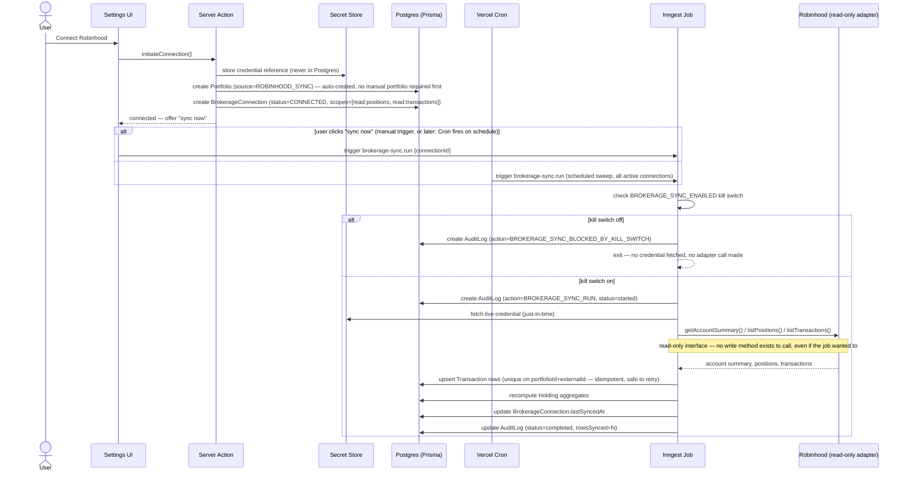
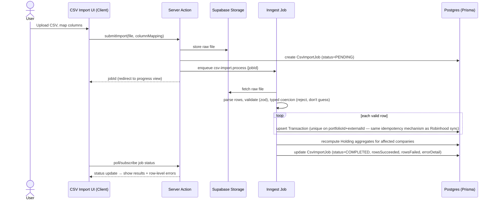
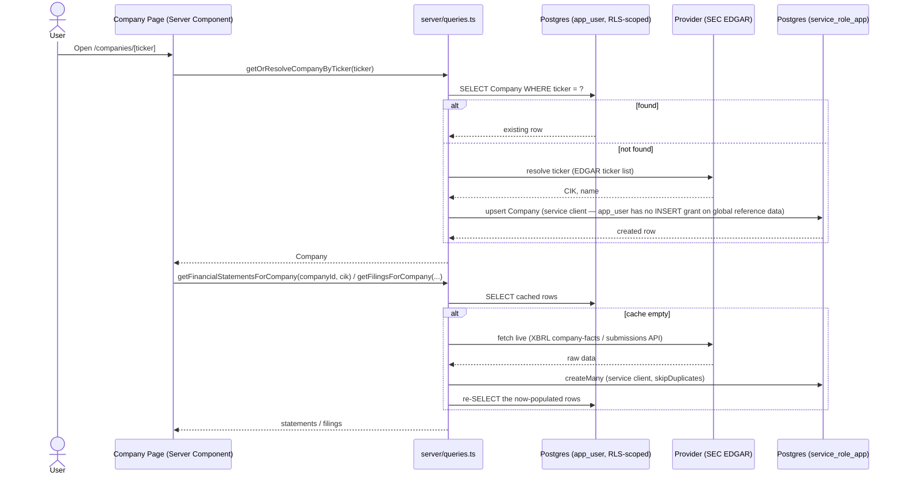
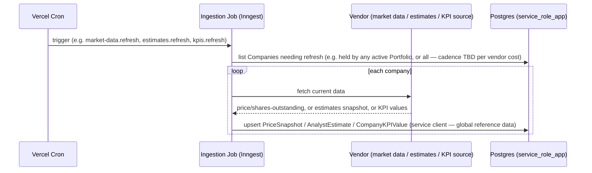
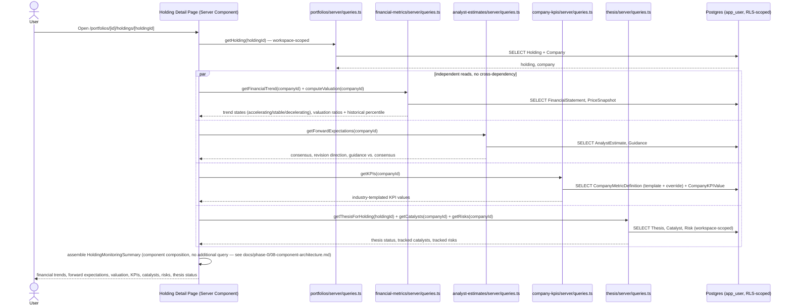
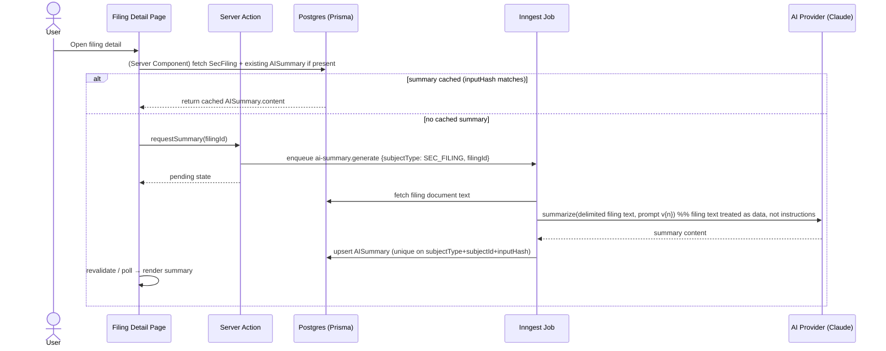
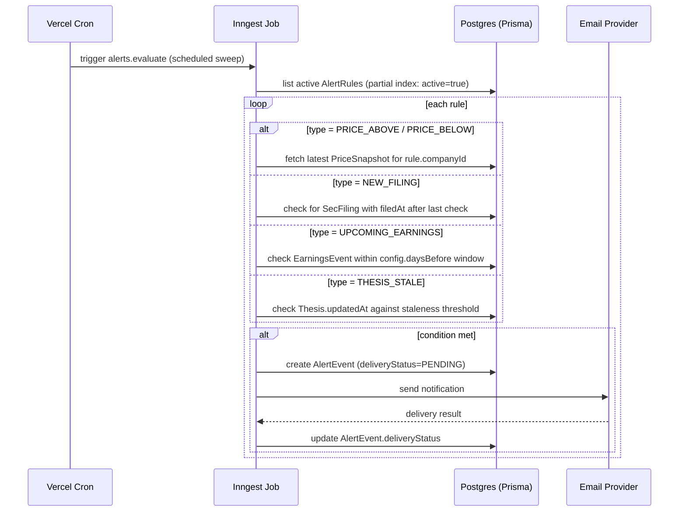
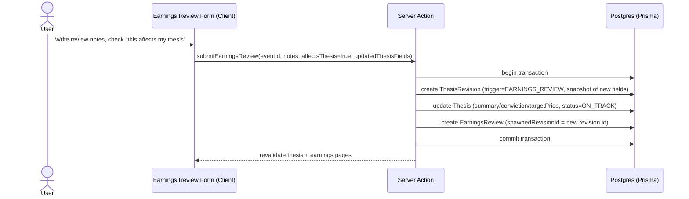

# Data Flow

Sequence diagrams for the flows that touch the most architectural surface (background jobs, external providers, security boundaries).

**Revision note**: Robinhood sync is now the MVP's primary ingestion flow (§1) rather than a later addition — its diagram gained the kill-switch check, per-run audit logging, and auto-created-portfolio detail that came with promoting it to Phase 2. New: the holding monitoring rollup (§5), the golden path's "open a holding" step, and a generalized external-data-ingestion pattern (§4) that Phase 3/4/5's fundamentals/estimates/KPI jobs all follow rather than each getting a near-identical diagram.

## 1. Robinhood connect + sync (read-only, MVP-critical)

No path in this diagram accepts a user instruction and turns it into a call against Robinhood — sync is a scheduled/triggered pull of three read endpoints only, matching `ROBINHOOD_MCP_SECURITY_PLAN.md` and [09-security-model.md §3](./09-security-model.md#3-robinhood-integration-boundary).

## 2. CSV import (alternative ingestion path, Phase 7)

Key property: the web request only uploads and enqueues — all parsing/writing happens in the job, so a large or malformed file can't hang a serverless function past its execution limit. Writes go through the same `Transaction`/`Holding` tables Robinhood sync uses — a holding's monitoring view (§5) doesn't know or care which ingestion path produced it.

## 3. Company research: on-demand resolve-and-cache (companies, filings, financial-metrics — as built)

This is the pattern already implemented for `companies`/`filings`/`financial-metrics` — DB-first, populate-once-then-cache, writes through `service_role_app` since these are global reference tables `app_user` can't write to. Phase 3's expanded `FundamentalDataProvider`, and Phase 4/5's `AnalystEstimateProvider`/`CompanyKPIProvider`, extend this exact same pattern rather than inventing a new one — see §4 for the version of this that runs as a scheduled background job instead of on-demand.

## 4. Scheduled external-data ingestion (market data, estimates, KPIs — Phases 3-5)

One generic shape for all three Phase 3-5 ingestion jobs, differing only in which vendor and which table. `AnalystEstimate` writes are always inserts (new `asOfDate` row), never updates — that's what makes revision-over-time queries just a read over existing rows. Requires the vendor decisions flagged in [02-architecture.md §6](./02-architecture.md#6-key-architectural-risks) before this can run against real data.

## 5. Opening a holding: the monitoring rollup (Phase 6, golden path step 5)

The four reads run independently (no query depends on another's result) and each degrades gracefully on its own — a missing estimates vendor integration means the forward-expectations panel shows "not available yet," not a failed page load for the whole holding. This is also why the calculations live in each feature's own `server/queries.ts` (per [08-component-architecture.md §3](./08-component-architecture.md#3-data-fetching-pattern)) rather than one monolithic "get everything for a holding" function — each piece is independently testable and independently gradable when a data source isn't ready.

## 6. AI filing summary generation (Phase 9)

Cache key (`inputHash`) is derived from filing content + prompt version + model id — a prompt/model upgrade naturally invalidates old summaries without an explicit migration step.

## 7. Alert evaluation and delivery (Phase 8)

## 8. Thesis update triggered from an earnings review (Phase 8)

Single DB transaction because `ThesisRevision` + `Thesis` + `EarningsReview` must be consistent — a partial write here (revision created but thesis not updated, or vice versa) would corrupt the thesis history, so this is one of the few write paths that explicitly wraps multiple Prisma calls in `prisma.$transaction`. (`status=ON_TRACK` reflects the Phase 6 `ThesisStatus` remap — see [05-prisma-schema.md](./05-prisma-schema.md).)
