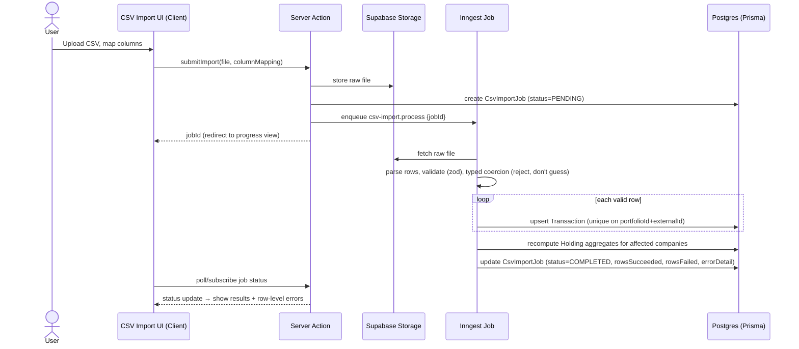
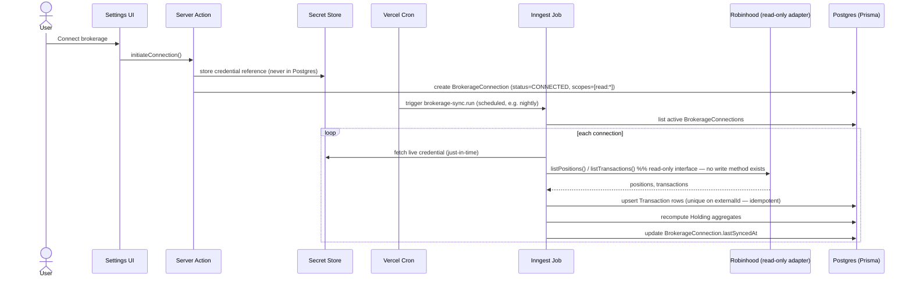
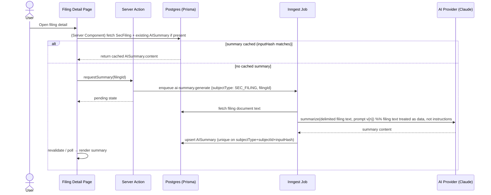
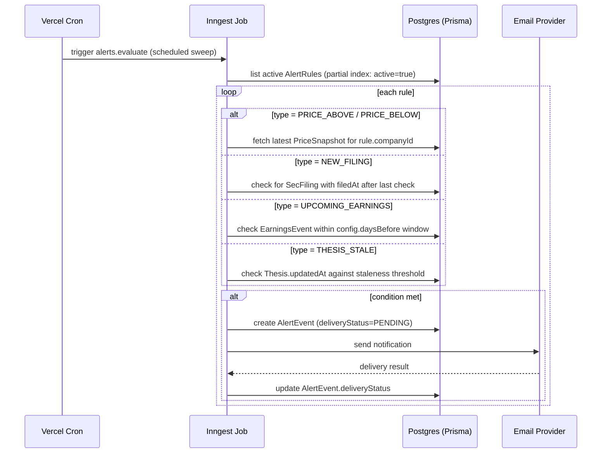

# Data Flow

Sequence diagrams for the flows that touch the most architectural surface (background jobs, external providers, security boundaries).

## 1. CSV import

Key property: the web request only uploads and enqueues — all parsing/writing happens in the job, so a large or malformed file can't hang a serverless function past its execution limit.

## 2. Robinhood sync (read-only)

No path in this diagram accepts a user instruction and turns it into a call against Robinhood — sync is a scheduled pull of read endpoints only, matching `ROBINHOOD_MCP_SECURITY_PLAN.md`.

## 3. AI filing summary generation

Cache key (`inputHash`) is derived from filing content + prompt version + model id — a prompt/model upgrade naturally invalidates old summaries without an explicit migration step.

## 4. Alert evaluation and delivery

## 5. Thesis update triggered from an earnings review

Single DB transaction because `ThesisRevision` + `Thesis` + `EarningsReview` must be consistent — a partial write here (revision created but thesis not updated, or vice versa) would corrupt the thesis history, so this is one of the few write paths that explicitly wraps multiple Prisma calls in `prisma.$transaction`.
